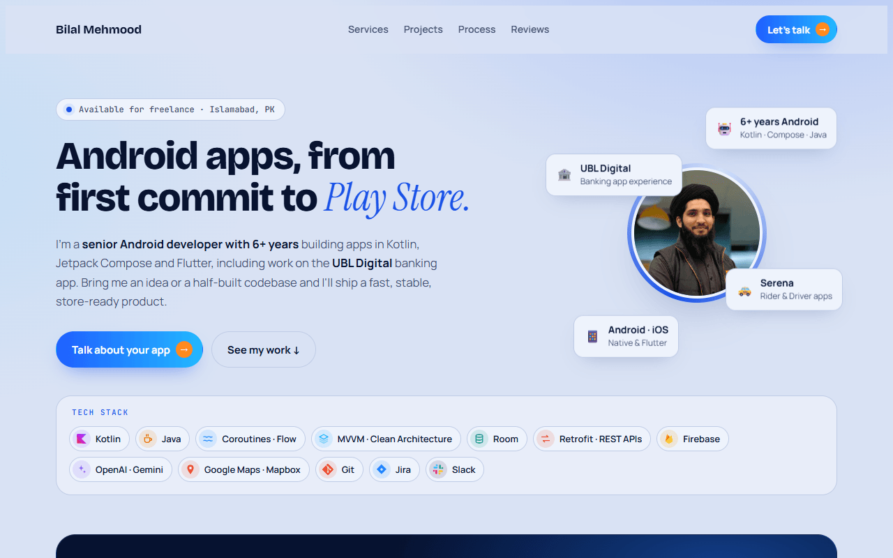
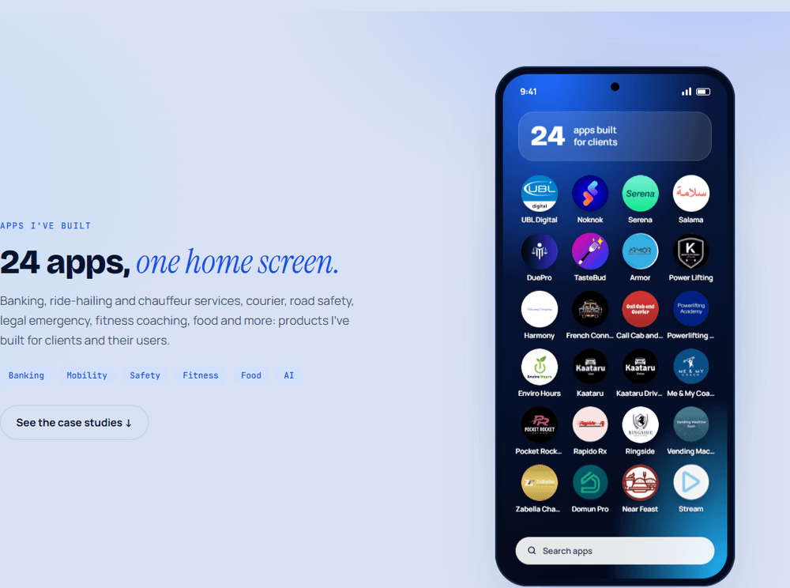
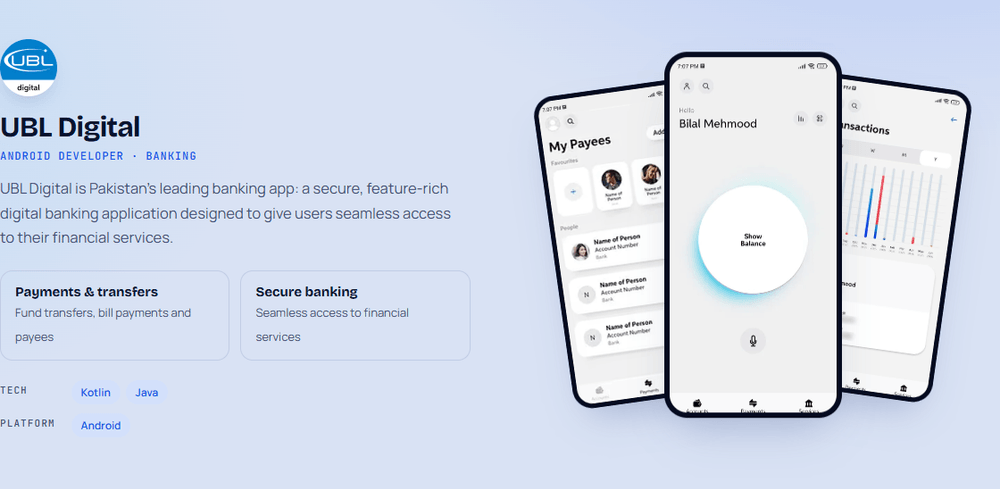

# Bilal Mehmood — Android Developer Portfolio

The source code of my personal portfolio website. I'm a **senior Android developer
with 6+ years** of experience building apps in Kotlin, from first commit to Play Store,
including work on the **UBL Digital** banking app.

**🌐 Live site: [bilal-mehmood-android.netlify.app](https://bilal-mehmood-android.netlify.app/)**



## What's on the site

- **Tech stack**: Kotlin, Java, Coroutines & Flow, MVVM / Clean Architecture,
  Room, Retrofit, Firebase, OpenAI & Gemini, Google Maps & Mapbox.
- **24 client apps** shown as icons on a phone home screen: banking, ride-hailing,
  courier, road safety, legal emergency, fitness coaching, food and more.
- **Case studies** with screenshots, features and tech for five apps:
  UBL Digital, Serena, Salama, DuePro and TasteBud.
- **Services, process and client reviews**: what I build, how I work, and what
  clients have said.





## Built with

Plain **HTML, CSS and vanilla JavaScript**. No framework and no build step, so the site
is fast, easy to host anywhere and simple to update.

- Responsive down to phone width
- Light theme in my brand colors (navy and electric blue)
- Subtle motion (floating phone mockups, icons popping in), switched off for visitors
  who prefer reduced motion
- Images compressed to WebP

## Run it locally

```bash
git clone https://github.com/BilalMehmood26/portfolio.git
cd portfolio
npx serve .
```

Then open the link it prints. You can also open the folder in VS Code and use the
**Live Server** extension.

## Project structure

```
index.html        page content and sections
css/styles.css    all styles (color tokens at the top)
js/main.js        small scripts (home-screen icon animation)
img/              photo, app logos and screenshots
docs/             README preview images
```

## Deploy

It's a static site. Upload `index.html`, `css/`, `js/` and `img/` to any static host,
such as GitHub Pages, Netlify, AWS Amplify or S3.

## Work with me

I build Android apps for startups and businesses: new apps, features on existing
codebases, Firebase backends and AI features.

- **Portfolio:** [bilal-mehmood-android.netlify.app](https://bilal-mehmood-android.netlify.app/)
- **Upwork:** [Hire me on Upwork](https://www.upwork.com/freelancers/~01d5fa7ac325688269)
- **LinkedIn:** [linkedin.com/in/bilalmehmood628](https://www.linkedin.com/in/bilalmehmood628/)
- **Email:** [bilalmehmood628@gmail.com](mailto:bilalmehmood628@gmail.com)

---

App names, logos and screenshots belong to their respective owners and are shown here
as examples of my work.
